# Machine Learning Complete Notes With Python

Date: 2026-07-09

These notes cover machine learning from beginner to advanced practical level using Python, pandas, NumPy, matplotlib/seaborn, and scikit-learn.

Official references checked:

- scikit-learn user guide: https://scikit-learn.org/stable/user_guide.html
- scikit-learn preprocessing: https://scikit-learn.org/stable/modules/preprocessing.html
- scikit-learn imputation: https://scikit-learn.org/stable/modules/impute.html
- scikit-learn model selection: https://scikit-learn.org/stable/modules/model_selection.html
- scikit-learn cross-validation: https://scikit-learn.org/stable/modules/cross_validation.html
- scikit-learn hyperparameter tuning: https://scikit-learn.org/stable/modules/grid_search.html
- scikit-learn clustering: https://scikit-learn.org/stable/modules/clustering.html
- scikit-learn ensembles: https://scikit-learn.org/stable/modules/ensemble.html
- pandas missing data: https://pandas.pydata.org/docs/user_guide/missing_data.html

---

## 1. What Is Machine Learning?

Machine learning means teaching computers patterns from data.

Traditional programming:

```text
rules + data -> answer
```

Machine learning:

```text
data + answers -> model/rules
```

Prediction:

```text
new data + trained model -> predicted answer
```

Example:

```text
past house data -> model learns relationship -> predicts price for new house
```

---

## 2. Why Use Machine Learning?

Use ML when:

- rules are too complex
- data has hidden patterns
- task changes over time
- prediction is useful
- many examples are available

Do not use ML when:

- simple rule works
- no useful data exists
- error cost is unacceptable
- result must be perfectly explainable
- maintaining the model is more expensive than benefit

---

## 3. Complete ML Roadmap

```mermaid
flowchart LR
    Problem["Problem definition"] --> Data["Data collection"]
    Data --> EDA["EDA"]
    EDA --> Cleaning["Cleaning"]
    Cleaning --> Features["Feature engineering"]
    Features --> Split["Train/validation/test split"]
    Split --> Model["Model training"]
    Model --> Evaluation["Evaluation"]
    Evaluation --> Tuning["Tuning"]
    Tuning --> Deploy["Deployment"]
    Deploy --> Monitor["Monitoring"]
    Monitor --> Retrain["Retraining"]
```



Steps:

1. Define the problem.
2. Decide target variable.
3. Collect data.
4. Understand data.
5. Clean data.
6. Engineer features.
7. Split data honestly.
8. Train baseline model.
9. Evaluate with correct metric.
10. Tune model.
11. Interpret model.
12. Deploy.
13. Monitor.
14. Retrain when needed.

---

## 4. Types of Machine Learning

### 4.1 Supervised Learning

Data has input and target.

Regression:

```text
input -> continuous number
```

Examples:

- house price
- sales forecast
- temperature prediction

Classification:

```text
input -> category/class
```

Examples:

- spam/not spam
- disease/no disease
- low/medium/high risk

### 4.2 Unsupervised Learning

Data has no target label.

Examples:

- clustering customers
- anomaly detection
- dimensionality reduction
- association rules

### 4.3 Semi-Supervised Learning

Small labeled data plus large unlabeled data.

### 4.4 Reinforcement Learning

Agent learns by actions and rewards.

---

## 5. Types of Variables

### 5.1 Numerical Variables

Continuous:

- height
- price
- temperature

Discrete:

- number of children
- number of purchases

### 5.2 Categorical Variables

Nominal:

- city
- color
- product type

No natural order.

Ordinal:

- low, medium, high
- beginner, intermediate, advanced

Natural order exists.

### 5.3 Date/Time Variables

Examples:

- order date
- signup time
- event timestamp

Can create features:

- year
- month
- day
- weekday
- hour
- weekend flag

### 5.4 Text Variables

Examples:

- review
- email body
- support ticket

Need text preprocessing or vectorization.

---

## 6. The ML Dataset Shape

Most ML tables look like:

```text
rows = examples/samples
columns = features
target = value to predict
```

Example:

| area | bedrooms | city | price |
|---|---:|---|---:|
| 1000 | 2 | Pune | 6000000 |
| 1500 | 3 | Mumbai | 15000000 |

Features:

```text
area, bedrooms, city
```

Target:

```text
price
```

In scikit-learn:

```python
X = df.drop(columns="price")
y = df["price"]
```

---

## 7. Data Cleaning

Data cleaning fixes problems before modeling.

Common problems:

- missing values
- duplicates
- wrong data types
- outliers
- inconsistent categories
- impossible values
- text noise
- mixed units

Data cleaning is often the most time-consuming and most important part of ML.

---

## 8. Load and Inspect Data

```python
import pandas as pd

df = pd.read_csv("data.csv")

print(df.head())
print(df.shape)
print(df.info())
print(df.describe())
print(df.isna().sum())
```

Line by line:

- `import pandas as pd`: import pandas.
- `read_csv`: load CSV file.
- `head`: first rows.
- `shape`: number of rows and columns.
- `info`: column types and missing counts.
- `describe`: summary statistics.
- `isna().sum()`: missing values per column.

---

## 9. Missing Values

Missing values mean data is absent.

Common representations:

- `NaN`
- `None`
- blank string
- `?`
- `-1` as fake missing value
- `unknown`

### 9.1 Find Missing Values

```python
missing_count = df.isna().sum()
missing_percent = df.isna().mean() * 100

print(missing_count)
print(missing_percent)
```

### 9.2 Why Missingness Matters

Missing values can mean:

- data entry error
- value not applicable
- measurement failed
- user refused to answer
- important signal

Types:

- MCAR: missing completely at random
- MAR: missing at random based on observed data
- MNAR: missing not at random

MNAR can be dangerous because missingness itself contains information.

---

## 10. Handling Missing Values by Dropping

Drop rows:

```python
df_dropped_rows = df.dropna()
```

Drop columns:

```python
df_dropped_columns = df.dropna(axis=1)
```

Drop if too many missing:

```python
threshold = 0.5
df = df.loc[:, df.isna().mean() < threshold]
```

Line by line:

- `df.isna().mean()`: missing ratio per column.
- `< threshold`: keep columns below threshold.
- `df.loc[:, ...]`: select all rows and selected columns.

Use dropping when:

- very few rows are missing
- column is mostly missing
- missing data is not informative

Avoid dropping blindly because it can remove useful data and introduce bias.

---

## 11. Handling Missing Values by Imputation

Imputation fills missing values.

### 11.1 Numeric Imputation

```python
df["age"] = df["age"].fillna(df["age"].median())
```

Median is robust to outliers.

### 11.2 Categorical Imputation

```python
df["city"] = df["city"].fillna(df["city"].mode()[0])
```

Mode is most frequent category.

Another approach:

```python
df["city"] = df["city"].fillna("Missing")
```

This keeps missingness as a signal.

### 11.3 scikit-learn Imputer

```python
from sklearn.impute import SimpleImputer

imputer = SimpleImputer(strategy="median")
X_train[["age"]] = imputer.fit_transform(X_train[["age"]])
X_test[["age"]] = imputer.transform(X_test[["age"]])
```

Line by line:

- import `SimpleImputer`.
- create median imputer.
- `fit_transform` on training data.
- `transform` test data with training median.

Important:

Never fit imputer on test data. That leaks information.

---

## 12. Encoding Categorical Variables

Machine learning models need numbers.

Categorical text must be encoded.

### 12.1 One-Hot Encoding

Use for nominal categories.

Example:

```text
city = Pune, Mumbai, Delhi
```

Becomes:

```text
city_Pune, city_Mumbai, city_Delhi
```

scikit-learn:

```python
from sklearn.preprocessing import OneHotEncoder

encoder = OneHotEncoder(handle_unknown="ignore", sparse_output=False)
encoded = encoder.fit_transform(df[["city"]])
```

Line by line:

- `handle_unknown="ignore"`: avoid error for unseen category in test data.
- `sparse_output=False`: return dense array.
- `fit_transform`: learn categories and encode.

### 12.2 Dummy Variables in pandas

```python
df_encoded = pd.get_dummies(df, columns=["city"], drop_first=True)
```

`drop_first=True` removes one category to reduce multicollinearity in linear models.

For production pipelines, prefer scikit-learn encoders inside a pipeline.

### 12.3 Label Encoding

Label encoding maps categories to integers.

```python
from sklearn.preprocessing import LabelEncoder

le = LabelEncoder()
y_encoded = le.fit_transform(y)
```

Use mainly for target labels, not unordered input features.

Why not for nominal input?

```text
red=0, blue=1, green=2
```

Some models may think green is greater than red, which is meaningless.

### 12.4 Ordinal Encoding

Use when category order matters.

```python
from sklearn.preprocessing import OrdinalEncoder

categories = [["low", "medium", "high"]]
encoder = OrdinalEncoder(categories=categories)
df[["quality"]] = encoder.fit_transform(df[["quality"]])
```

Meaning:

- low -> 0
- medium -> 1
- high -> 2

---

## 13. Outliers

Outlier is an unusually extreme value.

Examples:

- age = 300
- salary = 1000000000
- house area = 0

Outliers can be:

- data errors
- rare but valid events
- important signals

Never remove outliers blindly.

---

## 14. Remove Outliers Using IQR

IQR means interquartile range.

```text
IQR = Q3 - Q1
lower bound = Q1 - 1.5 * IQR
upper bound = Q3 + 1.5 * IQR
```

Code:

```python
column = "salary"

Q1 = df[column].quantile(0.25)
Q3 = df[column].quantile(0.75)
IQR = Q3 - Q1

lower = Q1 - 1.5 * IQR
upper = Q3 + 1.5 * IQR

df_no_outliers = df[(df[column] >= lower) & (df[column] <= upper)]
```

Line by line:

- calculate 25th percentile.
- calculate 75th percentile.
- calculate IQR.
- define lower and upper limits.
- keep rows inside limits.

---

## 15. Remove Outliers Using Z-Score

Z-score measures how many standard deviations a value is from mean.

```text
z = (x - mean) / standard_deviation
```

Code:

```python
from scipy.stats import zscore

z_scores = zscore(df["salary"].dropna())
mask = abs(z_scores) < 3
df_no_outliers = df.loc[df["salary"].dropna().index[mask]]
```

Use when data is approximately normally distributed.

IQR is often safer for skewed data.

---

## 16. Feature Scaling

Scaling changes numeric feature ranges.

Important for:

- KNN
- SVM
- logistic regression
- linear regression with regularization
- neural networks
- k-means
- PCA

Less important for:

- decision trees
- random forests
- gradient boosting trees

### 16.1 Standardization

Formula:

```text
z = (x - mean) / standard_deviation
```

Code:

```python
from sklearn.preprocessing import StandardScaler

scaler = StandardScaler()
X_train_scaled = scaler.fit_transform(X_train)
X_test_scaled = scaler.transform(X_test)
```

Output has roughly:

- mean 0
- standard deviation 1

### 16.2 Normalization

Min-max scaling:

```text
x_scaled = (x - min) / (max - min)
```

Code:

```python
from sklearn.preprocessing import MinMaxScaler

scaler = MinMaxScaler()
X_train_scaled = scaler.fit_transform(X_train)
X_test_scaled = scaler.transform(X_test)
```

Output usually ranges from 0 to 1.

---

## 17. Duplicate Data

Find duplicates:

```python
print(df.duplicated().sum())
```

Remove duplicates:

```python
df = df.drop_duplicates()
```

Duplicates can:

- bias training
- inflate accuracy if duplicated across train/test
- waste computation

---

## 18. Replace Values and Change Data Types

Replace:

```python
df["gender"] = df["gender"].replace({
    "M": "Male",
    "F": "Female"
})
```

Change type:

```python
df["age"] = df["age"].astype(int)
df["date"] = pd.to_datetime(df["date"])
```

Check:

```python
print(df.dtypes)
```

---

## 19. Function Transformer

`FunctionTransformer` lets you use a custom transformation inside scikit-learn pipeline.

```python
import numpy as np
from sklearn.preprocessing import FunctionTransformer

log_transformer = FunctionTransformer(np.log1p, feature_names_out="one-to-one")

X_train_log = log_transformer.fit_transform(X_train[["income"]])
```

Line by line:

- `np.log1p`: computes `log(1 + x)`, safe for zero.
- `FunctionTransformer`: wraps function as transformer.
- `fit_transform`: apply to training data.

Use for skewed numeric features.

---

## 20. Feature Selection

Feature selection chooses useful features.

Why:

- reduce noise
- improve speed
- reduce overfitting
- improve interpretability

### 20.1 Filter Methods

Use statistics before model training.

Examples:

- correlation
- chi-square
- mutual information

### 20.2 Wrapper Methods

Train model multiple times with different features.

Examples:

- forward selection
- backward elimination
- recursive feature elimination

### 20.3 Embedded Methods

Feature selection happens during model training.

Examples:

- Lasso
- tree feature importance

### 20.4 Recursive Feature Elimination

```python
from sklearn.feature_selection import RFE
from sklearn.linear_model import LinearRegression

model = LinearRegression()
selector = RFE(model, n_features_to_select=5)
selector.fit(X_train, y_train)

selected_columns = X_train.columns[selector.support_]
print(selected_columns)
```

---

## 21. Train Test Split

Split data:

```python
from sklearn.model_selection import train_test_split

X = df.drop(columns="target")
y = df["target"]

X_train, X_test, y_train, y_test = train_test_split(
    X,
    y,
    test_size=0.2,
    random_state=42
)
```

Line by line:

- `X`: features.
- `y`: target.
- `test_size=0.2`: 20 percent test.
- `random_state=42`: reproducible split.

For classification:

```python
X_train, X_test, y_train, y_test = train_test_split(
    X, y, test_size=0.2, random_state=42, stratify=y
)
```

`stratify=y` keeps class proportions similar.

---

## 22. Pipelines and ColumnTransformer

Pipelines prevent leakage and keep code clean.

```python
from sklearn.compose import ColumnTransformer
from sklearn.pipeline import Pipeline
from sklearn.preprocessing import OneHotEncoder, StandardScaler
from sklearn.impute import SimpleImputer
from sklearn.linear_model import LogisticRegression

numeric_features = ["age", "income"]
categorical_features = ["city", "gender"]

numeric_pipeline = Pipeline(steps=[
    ("imputer", SimpleImputer(strategy="median")),
    ("scaler", StandardScaler())
])

categorical_pipeline = Pipeline(steps=[
    ("imputer", SimpleImputer(strategy="most_frequent")),
    ("encoder", OneHotEncoder(handle_unknown="ignore"))
])

preprocessor = ColumnTransformer(transformers=[
    ("num", numeric_pipeline, numeric_features),
    ("cat", categorical_pipeline, categorical_features)
])

model = Pipeline(steps=[
    ("preprocessor", preprocessor),
    ("classifier", LogisticRegression(max_iter=1000))
])

model.fit(X_train, y_train)
predictions = model.predict(X_test)
```

Line by line:

- define numeric columns.
- define categorical columns.
- numeric pipeline imputes and scales.
- categorical pipeline imputes and one-hot encodes.
- `ColumnTransformer` applies correct pipeline to each column group.
- final pipeline combines preprocessing and model.
- `fit` learns preprocessing only from training data.
- `predict` applies same steps to test data.

This is one of the most important scikit-learn patterns.

---

## 23. Regression Analysis

Regression predicts continuous values.

Examples:

- price
- salary
- demand
- temperature

Common metrics:

- MAE
- MSE
- RMSE
- R2
- adjusted R2

---

## 24. Simple Linear Regression

Formula:

```text
y = m x + b
```

Where:

- `m`: slope
- `b`: intercept

Code:

```python
from sklearn.linear_model import LinearRegression
from sklearn.metrics import mean_absolute_error, r2_score

model = LinearRegression()
model.fit(X_train[["area"]], y_train)

y_pred = model.predict(X_test[["area"]])

print(mean_absolute_error(y_test, y_pred))
print(r2_score(y_test, y_pred))
print(model.coef_)
print(model.intercept_)
```

Line by line:

- import linear regression and metrics.
- create model.
- fit using one feature `area`.
- predict test target.
- calculate MAE.
- calculate R2.
- print slope.
- print intercept.

---

## 25. Multiple Linear Regression

Formula:

```text
y = b0 + b1*x1 + b2*x2 + ... + bn*xn
```

Code:

```python
features = ["area", "bedrooms", "age"]

model = LinearRegression()
model.fit(X_train[features], y_train)

y_pred = model.predict(X_test[features])
```

Each coefficient shows estimated effect of one feature when others are held constant, assuming linear model assumptions are reasonable.

---

## 26. Polynomial Regression

Polynomial regression adds powers of features.

```python
from sklearn.preprocessing import PolynomialFeatures
from sklearn.pipeline import Pipeline
from sklearn.linear_model import LinearRegression

model = Pipeline(steps=[
    ("poly", PolynomialFeatures(degree=2, include_bias=False)),
    ("linear", LinearRegression())
])

model.fit(X_train[["area"]], y_train)
y_pred = model.predict(X_test[["area"]])
```

Line by line:

- `PolynomialFeatures`: creates `x`, `x^2`, interactions.
- `degree=2`: quadratic features.
- `include_bias=False`: do not add constant column.
- LinearRegression learns on expanded features.

Polynomial features can overfit quickly.

---

## 27. Cost Function

Cost function measures model error.

For regression:

```text
MSE = mean((actual - predicted)^2)
```

Optimization means:

```text
find parameters that minimize cost
```

Gradient descent updates parameters step by step.

---

## 28. Regression Metrics

### 28.1 MAE

```python
from sklearn.metrics import mean_absolute_error

mae = mean_absolute_error(y_test, y_pred)
```

Average absolute error.

Easy to understand.

### 28.2 MSE and RMSE

```python
from sklearn.metrics import mean_squared_error
import numpy as np

mse = mean_squared_error(y_test, y_pred)
rmse = np.sqrt(mse)
```

RMSE penalizes large errors more than MAE.

### 28.3 R2 Score

```python
from sklearn.metrics import r2_score

r2 = r2_score(y_test, y_pred)
```

R2 measures how much variance the model explains.

### 28.4 Adjusted R2

```python
def adjusted_r2(r2, n, p):
    return 1 - (1 - r2) * (n - 1) / (n - p - 1)
```

Where:

- `n`: number of samples
- `p`: number of predictors

Adjusted R2 penalizes adding useless features.

---

## 29. Best Fit Line

The best fit line minimizes error between actual and predicted values.

For ordinary least squares:

```text
choose slope/intercept that minimize sum of squared residuals
```

Residual:

```text
actual - predicted
```

Visual:

```text
points scattered around a line
vertical distances from points to line = residuals
best line makes squared residuals as small as possible
```

---

## 30. Regularization: Ridge, Lasso, Elastic Net

Regularization penalizes model complexity.

### 30.1 Ridge Regression

L2 penalty:

```text
loss + alpha * sum(weights^2)
```

Code:

```python
from sklearn.linear_model import Ridge

model = Ridge(alpha=1.0)
model.fit(X_train, y_train)
```

Ridge shrinks coefficients but usually does not make them exactly zero.

### 30.2 Lasso Regression

L1 penalty:

```text
loss + alpha * sum(abs(weights))
```

Code:

```python
from sklearn.linear_model import Lasso

model = Lasso(alpha=0.1)
model.fit(X_train, y_train)
```

Lasso can make coefficients exactly zero, so it can perform feature selection.

### 30.3 Elastic Net

Combines L1 and L2.

```python
from sklearn.linear_model import ElasticNet

model = ElasticNet(alpha=0.1, l1_ratio=0.5)
model.fit(X_train, y_train)
```

---

## 31. Classification

Classification predicts categories.

Examples:

- churn yes/no
- fraud/not fraud
- disease class
- handwritten digit

Classification output can be:

- class label
- probability

---

## 32. Logistic Regression

Despite the name, logistic regression is used for classification.

It models probability using sigmoid.

```text
linear score -> sigmoid -> probability
```

Binary code:

```python
from sklearn.linear_model import LogisticRegression
from sklearn.metrics import accuracy_score

model = LogisticRegression(max_iter=1000)
model.fit(X_train, y_train)

y_pred = model.predict(X_test)
y_proba = model.predict_proba(X_test)[:, 1]

print(accuracy_score(y_test, y_pred))
```

Line by line:

- create logistic regression.
- `max_iter=1000`: allow more iterations if needed.
- fit training data.
- predict labels.
- predict probabilities for positive class.
- calculate accuracy.

### 32.1 Multiclass Logistic Regression

```python
model = LogisticRegression(max_iter=1000)
model.fit(X_train, y_train)
y_pred = model.predict(X_test)
```

scikit-learn handles multiclass classification automatically for supported solvers.

---

## 33. Confusion Matrix

For binary classification:

| | Predicted Negative | Predicted Positive |
|---|---:|---:|
| Actual Negative | TN | FP |
| Actual Positive | FN | TP |

Code:

```python
from sklearn.metrics import confusion_matrix, ConfusionMatrixDisplay

cm = confusion_matrix(y_test, y_pred)
print(cm)

ConfusionMatrixDisplay.from_predictions(y_test, y_pred)
```

Terms:

- TP: predicted positive and actual positive.
- TN: predicted negative and actual negative.
- FP: predicted positive but actual negative.
- FN: predicted negative but actual positive.

---

## 34. Classification Metrics

Accuracy:

```text
(TP + TN) / all predictions
```

Precision:

```text
TP / (TP + FP)
```

Recall or sensitivity:

```text
TP / (TP + FN)
```

F1:

```text
2 * precision * recall / (precision + recall)
```

Code:

```python
from sklearn.metrics import classification_report

print(classification_report(y_test, y_pred))
```

Use:

- precision when false positives are costly
- recall when false negatives are costly
- F1 when both matter

---

## 35. Imbalanced Dataset

Imbalanced dataset means one class is much more common.

Example:

```text
fraud = 1%
not fraud = 99%
```

Accuracy can mislead.

Solutions:

- stratified split
- class weights
- oversampling
- undersampling
- SMOTE
- threshold tuning
- use precision/recall/F1/AUPRC

Class weights:

```python
model = LogisticRegression(class_weight="balanced", max_iter=1000)
model.fit(X_train, y_train)
```

Threshold tuning:

```python
proba = model.predict_proba(X_test)[:, 1]
y_pred_custom = (proba >= 0.3).astype(int)
```

Lowering threshold increases recall but may reduce precision.

---

## 36. Naive Bayes

Naive Bayes uses Bayes theorem and assumes features are conditionally independent given class.

Types:

- GaussianNB for continuous numeric features
- MultinomialNB for counts, common in text
- BernoulliNB for binary features

Code:

```python
from sklearn.naive_bayes import GaussianNB

model = GaussianNB()
model.fit(X_train, y_train)
y_pred = model.predict(X_test)
```

Text example:

```python
from sklearn.feature_extraction.text import CountVectorizer
from sklearn.naive_bayes import MultinomialNB
from sklearn.pipeline import Pipeline

model = Pipeline(steps=[
    ("vectorizer", CountVectorizer()),
    ("classifier", MultinomialNB())
])

model.fit(text_train, y_train)
y_pred = model.predict(text_test)
```

Line by line:

- `CountVectorizer`: convert text to word counts.
- `MultinomialNB`: train Naive Bayes on counts.
- pipeline combines both.

---

## 37. Decision Tree Classification

Decision tree splits data using feature rules.

Example:

```text
if income > 50000:
    if age > 30:
        predict yes
    else:
        predict no
else:
    predict no
```

Code:

```python
from sklearn.tree import DecisionTreeClassifier

model = DecisionTreeClassifier(max_depth=4, random_state=42)
model.fit(X_train, y_train)
y_pred = model.predict(X_test)
```

Important hyperparameters:

- `max_depth`
- `min_samples_split`
- `min_samples_leaf`
- `criterion`

Trees can overfit if too deep.

---

## 38. Pre-Pruning and Post-Pruning

Pre-pruning controls growth during training.

```python
model = DecisionTreeClassifier(
    max_depth=5,
    min_samples_leaf=10,
    random_state=42
)
```

Post-pruning removes branches after tree is grown.

Cost complexity pruning:

```python
path = model.cost_complexity_pruning_path(X_train, y_train)
ccp_alphas = path.ccp_alphas
```

Train trees for different `ccp_alpha` values and choose best validation score.

---

## 39. Decision Tree Regression

```python
from sklearn.tree import DecisionTreeRegressor

model = DecisionTreeRegressor(max_depth=5, random_state=42)
model.fit(X_train, y_train)
y_pred = model.predict(X_test)
```

Decision tree regression predicts average target value in leaf nodes.

---

## 40. K-Nearest Neighbors

KNN predicts based on nearest training examples.

Classification:

```text
majority vote of nearest neighbors
```

Regression:

```text
average of nearest neighbors
```

KNN needs scaling.

Classification code:

```python
from sklearn.neighbors import KNeighborsClassifier
from sklearn.pipeline import Pipeline
from sklearn.preprocessing import StandardScaler

model = Pipeline(steps=[
    ("scaler", StandardScaler()),
    ("knn", KNeighborsClassifier(n_neighbors=5))
])

model.fit(X_train, y_train)
y_pred = model.predict(X_test)
```

Regression:

```python
from sklearn.neighbors import KNeighborsRegressor

model = Pipeline(steps=[
    ("scaler", StandardScaler()),
    ("knn", KNeighborsRegressor(n_neighbors=5))
])
```

---

## 41. Support Vector Machines

SVM tries to find a boundary with maximum margin.

For non-linear data, kernels help.

Common kernels:

- linear
- polynomial
- RBF

Classification:

```python
from sklearn.svm import SVC

model = Pipeline(steps=[
    ("scaler", StandardScaler()),
    ("svm", SVC(kernel="rbf", C=1.0, gamma="scale"))
])

model.fit(X_train, y_train)
y_pred = model.predict(X_test)
```

Regression:

```python
from sklearn.svm import SVR

model = Pipeline(steps=[
    ("scaler", StandardScaler()),
    ("svr", SVR(kernel="rbf", C=1.0))
])
```

Important:

- SVM can be strong on medium-sized datasets.
- Scaling is very important.
- Large datasets can be slow.

---

## 42. Parameters, Hyperparameters, and Tuning

Parameter:

```text
learned from data
```

Examples:

- linear regression coefficients
- tree split thresholds

Hyperparameter:

```text
chosen before training
```

Examples:

- `n_neighbors`
- `max_depth`
- `C`
- learning rate

Tuning means searching for good hyperparameters.

---

## 43. GridSearchCV

Grid search tries all combinations.

```python
from sklearn.model_selection import GridSearchCV

param_grid = {
    "knn__n_neighbors": [3, 5, 7, 9],
    "knn__weights": ["uniform", "distance"]
}

search = GridSearchCV(
    model,
    param_grid=param_grid,
    cv=5,
    scoring="accuracy"
)

search.fit(X_train, y_train)

print(search.best_params_)
print(search.best_score_)
```

Line by line:

- `param_grid`: hyperparameter combinations.
- `knn__n_neighbors`: parameter inside pipeline step named `knn`.
- `cv=5`: 5-fold cross-validation.
- `scoring`: metric.
- `best_params_`: best combination.

---

## 44. RandomizedSearchCV

Random search samples combinations.

```python
from sklearn.model_selection import RandomizedSearchCV
from scipy.stats import randint

param_distributions = {
    "max_depth": randint(2, 20),
    "min_samples_leaf": randint(1, 20)
}

search = RandomizedSearchCV(
    DecisionTreeClassifier(random_state=42),
    param_distributions=param_distributions,
    n_iter=30,
    cv=5,
    random_state=42
)

search.fit(X_train, y_train)
```

Use random search when grid is large.

---

## 45. Cross-Validation

Cross-validation estimates performance by training multiple times on different splits.

K-fold:

```text
split data into k folds
train on k-1 folds
validate on remaining fold
repeat k times
average score
```

Code:

```python
from sklearn.model_selection import cross_val_score

scores = cross_val_score(model, X, y, cv=5, scoring="accuracy")

print(scores)
print(scores.mean())
```

Use cross-validation for model selection, not final test evaluation.

---

## 46. Unsupervised Learning

Unsupervised learning finds structure without labels.

Common tasks:

- clustering
- dimensionality reduction
- anomaly detection
- association rules

---

## 47. K-Means Clustering

K-means groups data into `k` clusters.

Algorithm:

1. Choose k cluster centers.
2. Assign points to nearest center.
3. Move center to mean of assigned points.
4. Repeat.

Code:

```python
from sklearn.cluster import KMeans
from sklearn.preprocessing import StandardScaler
from sklearn.pipeline import Pipeline

model = Pipeline(steps=[
    ("scaler", StandardScaler()),
    ("kmeans", KMeans(n_clusters=3, random_state=42, n_init="auto"))
])

clusters = model.fit_predict(X)
```

Important:

- choose `k` carefully
- scaling matters
- sensitive to initialization
- works best for round-ish clusters

---

## 48. Hierarchical Clustering

Hierarchical clustering builds a tree of clusters.

Agglomerative:

```text
start with each point as cluster
merge closest clusters step by step
```

Code:

```python
from sklearn.cluster import AgglomerativeClustering

model = AgglomerativeClustering(n_clusters=3, linkage="ward")
clusters = model.fit_predict(X_scaled)
```

Dendrograms help visualize hierarchy, often using SciPy.

---

## 49. DBSCAN

DBSCAN groups dense regions and marks noise.

Important parameters:

- `eps`: neighborhood radius
- `min_samples`: minimum points to form dense region

Code:

```python
from sklearn.cluster import DBSCAN

model = DBSCAN(eps=0.5, min_samples=5)
clusters = model.fit_predict(X_scaled)
```

Cluster label `-1` means noise.

DBSCAN can find irregular shapes but struggles with varying densities.

---

## 50. Silhouette Score

Silhouette score measures cluster quality.

Range:

```text
-1 to 1
```

Higher is usually better.

Code:

```python
from sklearn.metrics import silhouette_score

score = silhouette_score(X_scaled, clusters)
print(score)
```

Do not use silhouette blindly. Combine with domain understanding.

---

## 51. Association Rule Learning

Association rules find items that occur together.

Example:

```text
if customer buys bread and butter, they may buy jam
```

Terms:

- support
- confidence
- lift

Support:

```text
how often itemset appears
```

Confidence:

```text
how often rule is true when antecedent appears
```

Lift:

```text
how much stronger than random chance
```

---

## 52. Apriori Algorithm

Apriori finds frequent itemsets using the idea:

```text
if an itemset is frequent, its subsets must also be frequent
```

Example with `mlxtend`:

```python
from mlxtend.frequent_patterns import apriori, association_rules

frequent_itemsets = apriori(
    basket_encoded,
    min_support=0.02,
    use_colnames=True
)

rules = association_rules(
    frequent_itemsets,
    metric="lift",
    min_threshold=1.0
)
```

Line by line:

- `basket_encoded`: one-hot transaction table.
- `min_support=0.02`: itemset must appear in at least 2 percent transactions.
- `use_colnames=True`: keep item names.
- generate rules with lift at least 1.

---

## 53. FP-Growth

FP-Growth is often faster than Apriori for large datasets.

```python
from mlxtend.frequent_patterns import fpgrowth

frequent_itemsets = fpgrowth(
    basket_encoded,
    min_support=0.02,
    use_colnames=True
)
```

Use for association rule mining when Apriori is too slow.

---

## 54. Ensemble Learning

Ensemble combines multiple models.

Why it works:

- different models make different errors
- averaging reduces variance
- voting improves robustness

Types:

- voting
- averaging
- bagging
- random forests
- boosting
- stacking

---

## 55. Voting and Averaging

Classification voting:

```python
from sklearn.ensemble import VotingClassifier
from sklearn.linear_model import LogisticRegression
from sklearn.tree import DecisionTreeClassifier
from sklearn.neighbors import KNeighborsClassifier

voting = VotingClassifier(
    estimators=[
        ("lr", LogisticRegression(max_iter=1000)),
        ("tree", DecisionTreeClassifier(random_state=42)),
        ("knn", KNeighborsClassifier())
    ],
    voting="hard"
)

voting.fit(X_train, y_train)
```

`hard` voting uses class votes.

`soft` voting averages predicted probabilities.

Regression averaging:

```python
from sklearn.ensemble import VotingRegressor
from sklearn.linear_model import LinearRegression
from sklearn.tree import DecisionTreeRegressor

regressor = VotingRegressor([
    ("linear", LinearRegression()),
    ("tree", DecisionTreeRegressor(random_state=42))
])
```

---

## 56. Bagging

Bagging trains many models on bootstrap samples.

Bootstrap sample:

```text
sample with replacement
```

Code:

```python
from sklearn.ensemble import BaggingClassifier
from sklearn.tree import DecisionTreeClassifier

model = BaggingClassifier(
    estimator=DecisionTreeClassifier(),
    n_estimators=100,
    random_state=42
)

model.fit(X_train, y_train)
```

Bagging reduces variance.

---

## 57. Random Forest

Random forest is bagging of decision trees plus random feature selection.

Classification:

```python
from sklearn.ensemble import RandomForestClassifier

model = RandomForestClassifier(
    n_estimators=200,
    max_depth=None,
    random_state=42,
    n_jobs=-1
)

model.fit(X_train, y_train)
```

Regression:

```python
from sklearn.ensemble import RandomForestRegressor

model = RandomForestRegressor(
    n_estimators=200,
    random_state=42,
    n_jobs=-1
)
```

Important:

- strong baseline
- handles non-linear relationships
- less scaling requirement
- can overfit but usually robust
- feature importance available

---

## 58. Boosting

Boosting trains models sequentially. Each model tries to fix previous errors.

Common algorithms:

- AdaBoost
- Gradient Boosting
- HistGradientBoosting
- XGBoost
- LightGBM
- CatBoost

scikit-learn:

```python
from sklearn.ensemble import GradientBoostingClassifier

model = GradientBoostingClassifier(random_state=42)
model.fit(X_train, y_train)
```

Histogram gradient boosting:

```python
from sklearn.ensemble import HistGradientBoostingClassifier

model = HistGradientBoostingClassifier(random_state=42)
model.fit(X_train, y_train)
```

Boosting can be very accurate but needs careful tuning.

---

## 59. Stacking

Stacking trains base models and a meta-model.

```python
from sklearn.ensemble import StackingClassifier

stack = StackingClassifier(
    estimators=[
        ("lr", LogisticRegression(max_iter=1000)),
        ("rf", RandomForestClassifier(random_state=42))
    ],
    final_estimator=LogisticRegression(max_iter=1000)
)

stack.fit(X_train, y_train)
```

Base models make predictions. Final model learns how to combine them.

---

## 60. Dimensionality Reduction

Dimensionality reduction reduces number of features.

Uses:

- visualization
- noise reduction
- speed
- compression

### 60.1 PCA

PCA finds directions of maximum variance.

```python
from sklearn.decomposition import PCA

pipeline = Pipeline(steps=[
    ("scaler", StandardScaler()),
    ("pca", PCA(n_components=2))
])

X_2d = pipeline.fit_transform(X)
```

PCA needs scaling.

---

## 61. Model Persistence

Save model:

```python
import joblib

joblib.dump(model, "model.joblib")
```

Load:

```python
model = joblib.load("model.joblib")
```

Save entire pipeline, not only estimator, so preprocessing is included.

---

## 62. End-to-End ML Project Example

```python
import pandas as pd
from sklearn.model_selection import train_test_split
from sklearn.compose import ColumnTransformer
from sklearn.pipeline import Pipeline
from sklearn.preprocessing import OneHotEncoder, StandardScaler
from sklearn.impute import SimpleImputer
from sklearn.ensemble import RandomForestClassifier
from sklearn.metrics import classification_report
import joblib

df = pd.read_csv("customers.csv")

X = df.drop(columns="churn")
y = df["churn"]

numeric_features = X.select_dtypes(include="number").columns
categorical_features = X.select_dtypes(exclude="number").columns

X_train, X_test, y_train, y_test = train_test_split(
    X, y, test_size=0.2, random_state=42, stratify=y
)

numeric_pipeline = Pipeline(steps=[
    ("imputer", SimpleImputer(strategy="median")),
    ("scaler", StandardScaler())
])

categorical_pipeline = Pipeline(steps=[
    ("imputer", SimpleImputer(strategy="most_frequent")),
    ("encoder", OneHotEncoder(handle_unknown="ignore"))
])

preprocessor = ColumnTransformer(transformers=[
    ("num", numeric_pipeline, numeric_features),
    ("cat", categorical_pipeline, categorical_features)
])

model = Pipeline(steps=[
    ("preprocessor", preprocessor),
    ("classifier", RandomForestClassifier(
        n_estimators=200,
        random_state=42,
        n_jobs=-1
    ))
])

model.fit(X_train, y_train)
y_pred = model.predict(X_test)

print(classification_report(y_test, y_pred))

joblib.dump(model, "churn_model.joblib")
```

Line by line summary:

- load data
- split features and target
- detect numeric/categorical columns
- split train/test with stratification
- define numeric preprocessing
- define categorical preprocessing
- combine preprocessing
- create full model pipeline
- train
- predict
- evaluate
- save pipeline

---

## 63. Model Interpretation

Interpretation helps understand model behavior.

Techniques:

- coefficients for linear models
- tree feature importance
- permutation importance
- partial dependence plots
- SHAP values

Permutation importance:

```python
from sklearn.inspection import permutation_importance

result = permutation_importance(
    model,
    X_test,
    y_test,
    n_repeats=10,
    random_state=42
)

print(result.importances_mean)
```

Idea:

```text
shuffle one feature
measure score drop
large drop means feature mattered
```

---

## 64. Common ML Pitfalls

- data leakage
- fitting preprocessors on test data
- using accuracy on imbalanced data
- overfitting hyperparameters to validation set
- ignoring business metric
- not checking missing values
- not checking duplicates
- not setting random seeds
- comparing models on different splits
- deploying notebook code without pipeline
- ignoring drift after deployment

---

## 65. ML Deployment

Deployment means making model available for real use.

Options:

- batch predictions
- API service
- embedded in app
- database scoring job

FastAPI example:

```python
from fastapi import FastAPI
import joblib
import pandas as pd

app = FastAPI()
model = joblib.load("churn_model.joblib")

@app.post("/predict")
def predict(record: dict):
    df = pd.DataFrame([record])
    prediction = model.predict(df)[0]
    probability = model.predict_proba(df)[0].max()
    return {
        "prediction": str(prediction),
        "confidence": float(probability)
    }
```

Line by line:

- create API app.
- load saved model pipeline.
- define POST endpoint.
- convert input JSON to one-row DataFrame.
- predict class.
- get maximum probability.
- return JSON.

---

## 66. MLOps

MLOps is machine learning operations.

It covers:

- reproducible training
- data versioning
- model registry
- CI/CD
- deployment
- monitoring
- retraining
- governance

Monitor:

- input drift
- prediction drift
- model performance
- latency
- errors
- data quality

---

## 67. Interview Questions

### 67.1 What is overfitting?

Model performs very well on training data but poorly on unseen data.

### 67.2 What is underfitting?

Model is too simple or poorly trained and performs badly on both training and test data.

### 67.3 Why split train and test?

To estimate performance on unseen data.

### 67.4 Why use cross-validation?

To get a more stable estimate of model performance and tune hyperparameters.

### 67.5 Why use pipelines?

To prevent leakage and keep preprocessing/model steps reproducible.

### 67.6 Difference between bagging and boosting?

Bagging trains models independently on bootstrap samples. Boosting trains models sequentially to fix previous errors.

### 67.7 Why scale features?

Distance-based and gradient-based models are affected by feature scale.

### 67.8 What is regularization?

A penalty that discourages overly complex models and reduces overfitting.

---

## 68. Algorithm Selection Cheat Sheet

Regression:

- LinearRegression: baseline linear relationships
- Ridge/Lasso: regularized linear models
- DecisionTreeRegressor: non-linear, interpretable
- RandomForestRegressor: strong general baseline
- GradientBoosting/HistGradientBoosting: high accuracy tabular model
- SVR: medium-sized scaled data
- KNNRegressor: simple distance-based baseline

Classification:

- LogisticRegression: strong baseline
- NaiveBayes: text/simple probabilistic tasks
- DecisionTree: interpretable but overfits
- RandomForest: strong baseline
- GradientBoosting: high accuracy
- SVM: strong on medium-sized scaled data
- KNN: simple but can be slow

Clustering:

- KMeans: round clusters, choose k
- Agglomerative: hierarchy
- DBSCAN: dense irregular clusters and noise

Association:

- Apriori: frequent itemsets
- FP-Growth: faster frequent itemsets

---

## 69. Final ML Mental Model

Machine learning is:

```text
problem -> data -> features -> model -> predictions -> evaluation -> improvement -> deployment -> monitoring
```

For every ML project, ask:

1. What exactly are we predicting?
2. What data is available at prediction time?
3. Is there leakage?
4. What metric matches the real goal?
5. What is the simplest baseline?
6. Does the model beat the baseline?
7. Does it generalize?
8. Can it be explained enough?
9. Can it be deployed safely?
10. How will it be monitored?

Good ML is not only algorithms. It is data quality, honest evaluation, clear objectives, and reliable operation.

